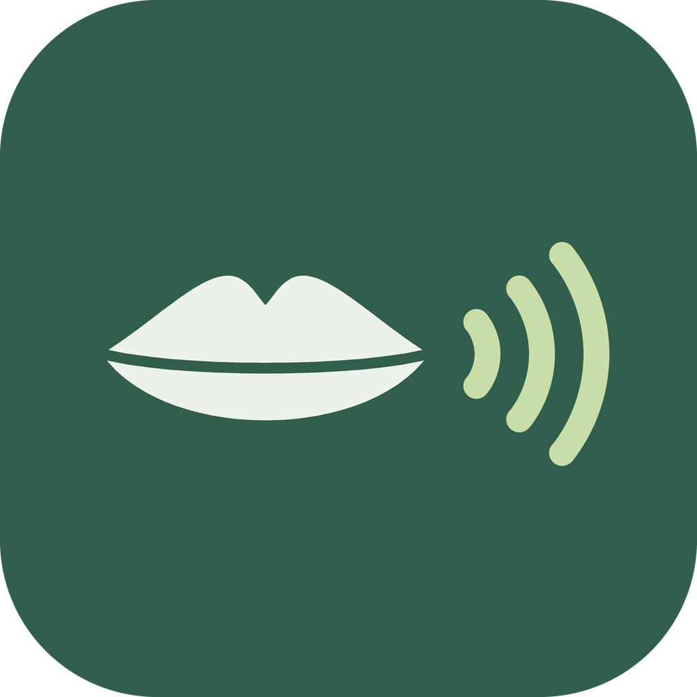
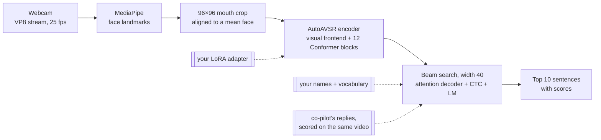
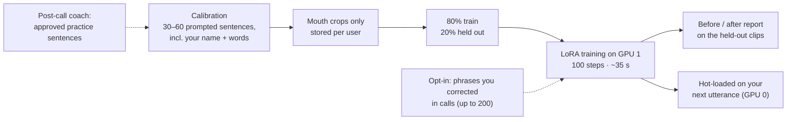
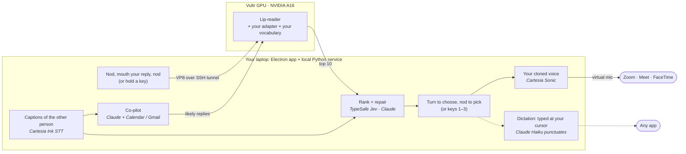

<div align="center">



# Silent Calls

### Take a call without making a sound.

Mouth your reply at your webcam. A lip-reading model on a cloud GPU reads it, a personal adapter trained on
*your* lips in 35 seconds makes it read you better, and Silent Calls says it into Zoom, Meet or FaceTime
**in your own cloned voice**, or types it into whatever app you're in. Fully hands-free: nod, mouth, nod.


[](requirements.txt)
[](server/requirements-gpu.txt)
[](client/package.json)
[](silentcalls/copilot.py)
[](silentcalls/voice.py)
[](server/setup_gpu.sh)

[Features](#features) · [How it works](#how-it-works) · [Results](#results) · [Built with](#built-with) · [Run it](#run-it) · [Privacy](#privacy-and-safety) · [Full results log](docs/RESULTS.md)

</div>

---

<table>
<tr>
<td align="center" width="25%"><h2>35 s</h2>to train a personal lip-reading adapter on your face<br/><sub>1.2M parameters, 0.5% of the model</sub></td>
<td align="center" width="25%"><h2>37% → 31%</h2>word error rate on sentences the adapter never saw<br/><sub>no change on anyone else: it's personal</sub></td>
<td align="center" width="25%"><h2>0.92 s</h2>from the end of your phrase to 10 sentence guesses<br/><sub>1.3 s over venue Wi-Fi</sub></td>
<td align="center" width="25%"><h2>77%</h2>right sentence on top once the co-pilot anticipates the reply<br/><sub>up from 36%</sub></td>
</tr>
</table>

## Why

Some people can move their lips but can't speak aloud: after a laryngectomy or vocal-cord surgery, with
voice loss from ALS or Parkinson's, on doctor-ordered voice rest. Everyone else sometimes needs to answer a call
where they can't talk: a library, a hospital ward, next to a sleeping baby.

Today the options are typing into a chat box (if the call has one) or not taking the call. **Silent Calls keeps
them in the conversation, in their own voice**, on the call apps they already use, with no extra hardware beyond
a webcam.

## Features

| | |
|---|---|
| 🧠 **Personal lip-reading** | A GPU lip-reading model plus an adapter trained on your own lips in ~35 s, which keeps learning from the phrases you correct in calls (opt-in). |
| 🙂 **Hands-free by default** | Nod to start, mouth your reply, nod to finish. Turn your head to move through the options, nod to say one, shake to cancel. Gesture sizes are tuned to you in onboarding. A hold-to-talk key and clicks still work. |
| 🗣️ **Your own voice** | Cloned from a short recording in onboarding and spoken into any call app through a virtual microphone, ~90 ms after you pick. |
| 📅 **Co-pilot** | While the other person talks, Claude drafts 2–3 likely replies from the conversation, your calendar and your email. The lip-reader scores them against your lips, or you tap **Say it**. |
| ⌨️ **Dictation** | Flip a switch and your picks are typed at the cursor in any app instead of spoken, with Claude adding capitals and punctuation without changing a word. |
| 📷 **Camera coach** | One short tip at a time about light, framing, pose and timing. It learns from your own results which tips actually help you. |
| 🔍 **Show work** | A compact strip under your webcam that opens into everything the lip-reader saw: every guess, which were co-pilot replies, the ranking, and where each fact came from. |
| 📝 **Post-call coach** | After a call, Claude proposes words and practice sentences from the places lip-reading struggled. You approve each one. |

## How it works

### 1. Read the lips: a visual speech recognition model on the GPU



While you mouth a sentence (between two nods, or while holding a key), the app streams video to an NVIDIA A16 on
Vultr. With frames streamed
as they're captured, face detection finishes while you mouth, so once you finish only the mouth crop,
the encoder and the beam search are left: **0.92 s** median to a ranked top 10. On weak Wi-Fi the app sends a
compressed VP8 stream instead, decoded once you finish: **1.3 s** end to end over the venue's network.

The model is **AutoAVSR** (visual-only, LRS3, ~250M parameters, 19.1% WER on its benchmark), which knows nothing
about your face, your webcam or your conversation. We extended its decoder in three ways
([`server/lipread/model.py`](server/lipread/model.py)):

- **Personal adapters** (below): a per-user LoRA inside the encoder, swapped in per request.
- **Vocabulary bias:** a beam scorer that rewards subword pieces spelling one of your names or words, and takes
  the bonus back if the word isn't finished. No false names in 102 clips with no names spoken.
- **Closed-set scoring:** sentences we expect you might say are scored against the video with exactly the
  log-probability a beam hypothesis would get, then ranked alongside the beam's own guesses (step 3).

We also tuned the decoder on our own clips (LM weight 0.2, CTC weight 0.1, beam 40) and moved the client from
JPEG frames to a VP8 stream so it works on venue Wi-Fi.

### 2. Learn your lips: a personal adapter in 35 seconds



People mouth words differently, and a pretrained model reads some of us far better than others (16% WER for one of
our testers, 57% for another). So the app has a 10-minute calibration: you mouth 30–60 prompted call sentences,
including ones built from your own name and vocabulary, and the server trains an adapter just for you
([`server/lora/`](server/lora/)):

| | |
|---|---|
| **What's trained** | Rank-16 LoRA (alpha 32) on the query/key/value/output projections of all 12 Conformer blocks: 1.18M parameters, 0.5% of the model. Visual frontend, decoder and LM stay frozen. |
| **Recipe** | 100 steps, batch 8, AdamW lr 1e-3 with warm-up + cosine decay, fp16. The checkpoint's own loss (0.1 × CTC + 0.9 × attention). Augmentation from the AutoAVSR recipe: random 88×88 crops and adaptive time masking. |
| **Where** | GPU 1 of the A16, as a subprocess, so training never slows a live call on GPU 0. ~0.35 s per step. |
| **How we chose it** | Cross-validated sweeps: rank 8 vs 16, attention-only vs attention + feed-forward (overfits), 50–300 steps, 6–24 training sentences. Rank 16 at lr 1e-3 matches 300 steps of rank 8 in a third of the time. |
| **Keeps learning** | Opt in to "Learn from my corrections" and every phrase you fix in a call (another option, an edit, or Claude's suggestion) keeps that capture's mouth crop with the text you confirmed. Retraining adds them to the training set only, so the before/after report stays honest. |
| **Is it personal?** | Yes. Your adapter cuts WER by about a sixth on sentences it never saw; someone else's adapter on your lips does nothing (control below). |

The adapter is written per user and loaded only for that user's requests; retraining reloads it on the next
utterance with no added latency.

### 3. In a call: the conversation fills in what lips can't carry



1. **Nod, mouth your reply, nod again.** Hands-free is the default (a hold-to-talk key still works); a head shake
   cancels. The lip-reader decodes the clip with your adapter and vocabulary, including names it picked up from
   your calendar invites, the people who email you most, and the call itself.
2. **The co-pilot's replies are scored against the same video.** As soon as the other person's live caption pauses
   (Cartesia STT), Claude drafts 2–3 likely replies from the conversation and, read-only, your calendar and email.
   They appear as cards you can tap (**Say it**), and the model also scores each one on your lips: *your mouthing
   picks the reply*, and the co-pilot supplies what lips can't show (times, order numbers, names). With the right
   reply in the list, the top guess is right **77%** of the time instead of 36%; when it isn't, nothing gets worse.
3. **Jev ranks the options with the conversation**, and Claude offers a repaired sentence when the lip-reader is
   close but wrong (p/b/m and f/v look identical on lips).
4. **You pick one.** Turn your head to move through the top 3 and Claude's suggestion, nod to say it (or press
   1–3). It's spoken in your cloned voice through a virtual microphone, ~90 ms to first audio. In **dictation**
   mode it's typed at your cursor instead. **Nothing is ever spoken or typed without your pick.**

Around the loop: the **compact companion** sits under your webcam and opens into **show work**; the **camera coach**
gives one tip at a time when your light, framing or timing is hurting the lip-reader; and after the call the
**post-call coach** proposes words and practice sentences, which feed the vocabulary bias and your next calibration.

## Results

Measured on **90 silently mouthed call sentences from 3 people**, recorded on ordinary laptop webcams, plus
spoken-aloud clips as a control. Out of the box, the pretrained model puts the right sentence first **36%** of the
time and in its top 10 **56%** of the time. Each accuracy number links to a run folder in
[`server/results/`](server/results/) with per-clip CSVs and every N-best list; the full log with every sweep and
timing is [docs/RESULTS.md](docs/RESULTS.md).

> **Metrics.** *WER*: word error rate of the top guess. *exact@K*: the exact sentence is among the top K guesses.
> *within1@5*: some top-5 guess is at most one word off.

### Headline

| | Before | After |
|---|---|---|
| **Personal LoRA adapter**, sentences it never saw | WER 37%, exact@5 49%, within1@5 64% | WER **31%**, exact@5 **56%**, within1@5 **73%** |
| Same adapter on *someone else's* lips (control) | WER 37% | WER 37%: **the gain is personal** |
| Biggest single gain (one tester, own adapter) | WER 38% | WER **21%** |
| **Co-pilot anticipated the reply** (closed-set scoring, +60 ms) | top guess 36%, WER 37% | top guess **77%**, top 3 **84%**, WER **19%** |
| **Jev reranking with the call context** | top 1 31%, top 3 41% | top 1 **42%**, top 3 **56%** |

### Latency, end to end

| Stage | Measured |
|---|---|
| Lip-read after you finish the phrase (A16, face detection hidden while you mouth) | **0.92 s** median |
| Key release → candidates on the laptop, over venue Wi-Fi | **1.3 s** median |
| Personal adapter training (100 steps on one A16) | **~35 s** |
| Jev ranking (warm connection) | **80–250 ms** |
| Pick → first audio in your cloned voice | **87–95 ms** |
| Co-pilot replies ready after the other person's line | **2.3 s** (2.9 s with an email search) |
| Claude repair offered as an extra option | ~3 s |
| Dictation: Claude's punctuated version ready (live) | **1.0–1.8 s** per sentence |

<details>
<summary><b>Personal adapters: cross-validated, with a control</b></summary>
<br/>

5-fold cross-validation by sentence: each person's 30 sentences are split into 5 groups, an adapter trains on 24 and
is scored on the 6 it never saw, so every clip is scored by an adapter that didn't train on it
([`lora_cv5_final_r16_s100_lm0.2`](server/results/lora_cv5_final_r16_s100_lm0.2/crossval.md)). The control scores
each adapter on the *other two people's* clips of the same held-out sentences.

| | clips | WER | exact@1 | exact@5 | exact@10 | oracle WER@10 | within1@5 |
|---|---|---|---|---|---|---|---|
| base model | 90 | 37% | 36% | 49% | 56% | 24% | 64% |
| **own adapter** (100 steps) | 90 | **31%** | **40%** | **56%** | **60%** | **18%** | **73%** |
| other people's clips, someone else's adapter | 180 | 37% | 35% | 49% | 56% | 24% | 65% |

Per person, WER base → own adapter: Rahul 38% → **21%**, Sarvajith 15% → 13%, Nilesh 59% → 58% (his clips were
cut off and fast, which no adapter fixes). It learns how *you* mouth words and your camera, not the sentences.

**Finding the recipe** (same cross-validation, all 90 clips; base is 38% WER / 53% exact@10 at the older LM weight):

| adapter | trainable params | steps | WER | exact@10 | training time |
|---|---|---|---|---|---|
| rank 8, attention only, lr 5e-4 | 590k | 300 | 29% | 60% | ~110 s |
| rank 8, attention + feed-forward | 2.06M | 300 | 34% | 60% | ~110 s |
| **rank 16, attention only, lr 1e-3** | 1.18M | **100** | 29% | 61% | **~35 s** |

**How much calibration is enough?** Final recipe, training on only N sentences:

| training sentences | 0 | 6 | 12 | 18 | 24 |
|---|---|---|---|---|---|
| WER | 37% | 38% | 34% | **28%** | 31% |
| exact@10 | 56% | 52% | 56% | **64%** | 60% |

Six sentences hurt (the adapter memorizes them); the full gain is there by 18. The app requires 30 clips (24 to
train, 6 for its before/after report) and asks for 60.

**First real enrollments** through the app (small held-out sets, so anecdotes rather than measurements): Rahul's
held-out WER 34% → 13%; Sarvajith's adapter, scored on the separate 30-sentence test set, exact@10 83% → 90%.

</details>

<details>
<summary><b>Decoder tuning and name biasing</b></summary>
<br/>

**Decoder sweep** ([`sweep.md`](server/results/sweep.md)), no training, 90 silent clips:

| LM weight | CTC weight | WER | exact@1 | exact@10 |
|---|---|---|---|---|
| 0.0 | 0.1 | 41% | 33% | 53% |
| 0.1 | 0.1 | 40% | 34% | 53% |
| **0.2** | **0.1** | **37%** | **36%** | **56%** |
| 0.3 (old default) | 0.1 | 38% | 32% | 53% |
| 0.5 | 0.1 | 39% | 30% | 48% |

A lighter LM also leaves more room for conversation context. Beam 20 would save 0.26 s for ~2 points of exact@10;
we keep 40 because the network, not the GPU, dominates the delay.

**Names.** On 102 clips with 8 names passed as vocabulary and **no names spoken**, a bias of 2.0 put **no false
name in any top 10**, for +75 ms ([`names_vocab_biasonly`](server/results/names_vocab_biasonly/summary.md)). At 4,
hypotheses that keep spelling names survive so long the beam ran out of GPU memory, so 2.0 stays. Lip-shape name
swaps were noisy (*"like a"* looks like *"anika"*, *"pray"* like *"priya"*) and are off by default. Live, *"hi my
name is Rahul"* came out as *"hi my name is **wrong**"*; Claude's repair, knowing "Rahul" is a likely name, offered
**"Hi, my name is Rahul."**

</details>

<details>
<summary><b>Bandwidth: making it work on venue Wi-Fi</b></summary>
<br/>

The venue uplink measured ~0.5 MB/s, too slow for JPEG frames. We switched the client to a VP8 stream from
`MediaRecorder` and decode on the server.

| Client sends | Upload | WER | exact@10 | Key release → candidates over venue Wi-Fi |
|---|---|---|---|---|
| JPEG 480p q80 | 1.1 MB/s | 37% | 56% | **10.7 s** median (1.8–23 s) |
| VP8 480p, 1 Mbps | 125 KB/s | 38% | 49% | **1.29 s** median (0.93–2.1 s) |
| VP8 480p, 2 Mbps (app default) | 250 KB/s | 37% | 53% | |

Also tested: 360p–720p frames, face crops from 96 to 320 px, JPEG quality 30–80, VP8 at 250 kbps–2 Mbps. Full
tables in [docs/RESULTS.md §2–3](docs/RESULTS.md#2-live-path-frames-streamed-as-jpegs-as-the-desktop-app-sends-them).

</details>

<details>
<summary><b>Closed-set scoring: how the co-pilot's replies meet the lip-reader</b></summary>
<br/>

Among a short list, **the true sentence is the best-scoring one 98–99% of the time**, but the beam's own best guess
always wins on likelihood alone (the beam is a likelihood maximizer), so prepared replies get a prior bonus *B*.
Choosing *B* offline ([`given_scores`](server/results/given_scores/sweep.md), lists of 5):

| B | truth among 4 others: top 1 | truth among 4 look-alikes: top 1 | only one-word-off replies: a wrong one wins |
|---|---|---|---|
| 0 | 32% | 32% | 0% |
| 4 | 59% | 59% | 0% |
| **8** | **77%** | **77%** | **1%** |
| 12 | 88% | 88% | 16% |
| 15 | 90% | 90% | 53% |

Through the real decoding path at B = 8 ([`given_d4_bonus8`](server/results/given_d4_bonus8/summary.md)):

| Co-pilot's list | WER | exact@1 | exact@3 | wrong reply on top |
|---|---|---|---|---|
| none (lip-reading alone) | 37% | 36% | 43% | – |
| contains what was said (+4 other sentences) | **19%** | **77%** | **84%** | 0% |
| contains what was said (+4 look-alikes) | **19%** | **77%** | **84%** | 0% |
| doesn't contain it | 37% | 36% | 43% | 0% |

The lips really do separate near-identical sentences: with the truth plus 4 one-word-off replies, the truth still
wins 77% of the time.

</details>

<details>
<summary><b>Conversation context: Jev and decision weights</b></summary>
<br/>

- **Fusion** (`silentcalls/fit_weights.py`): w_lip 0.5, w_jev 1.2. At combined score ≥ 0.97, 14 of 90 clips were
  all correct. Auto-speak is still **off**: the user always picks.
- **In practice:** with *"hi server jet yes i can"*, *"hi so very yes i can"*, *"hi sarvajith yes i can"* and
  Sarvajith as a likely name, Jev ranked the lip-reader's **third** guess first at 87%.
- **Keeping the connection warm** cut Jev's latency from ~1 s (over the 0.5 s budget) to 98–245 ms.

</details>

<details>
<summary><b>Choosing the Claude model for the co-pilot</b></summary>
<br/>

[`tools/copilot_bench.py`](tools/copilot_bench.py): 12 scripted calls against a fake calendar and inbox (order
numbers, confirmation codes, calendar conflicts, an honest "let me check" when the fact doesn't exist), 3 runs per
model ([`results/copilot_models/`](results/copilot_models/)).

| Model | Right reply in list | Right reply first | Invented facts | Median latency (no search / search) | Cost per line |
|---|---|---|---|---|---|
| **Opus 5.5, fast mode** (shipped) | 100% | 97% | 0 | **1.4 s / 2.2 s** | $0.032 |
| Opus 5.5 | 100% | 100% | 0 | 3.3 s / 4.9 s | $0.016 |
| Sonnet 5.5 | 100% | 100% | 0 | 2.3 s / 3.9 s | $0.008 |
| Haiku 5.5 | 97% | 81% | 0 | 2.9 s / 3.8 s | $0.0005 |

Fast mode is the only setting with replies ready in about 2 s, before the user has finished mouthing. Sonnet 5.5 is
the fallback.

</details>

<details>
<summary><b>Hands-free gestures: tuned from real face recordings</b></summary>
<br/>

The app runs MediaPipe face landmarks locally (the same pass feeds the mouth meter and the camera coach). We first
started captures by detecting mouthing, then recorded 15 s of a real face to tune it: silent mouthing barely moved
the readings (lip gap at most ~3% of mouth width), while the biggest jumps came from the face being lost and found
again, and from a smile. Head pose was steady to about half a degree. So the default became **nod to start, nod to
finish**, with mouthing-to-start as an option.

- A natural nod moved the head 4–6°. Gesture practice in onboarding measures your own nod and turn and saves 60% of
  each as your thresholds (nod 3.5–10°, turn 6–18°), per profile.
- A nod counts once the head is halfway back, so leaning in to mouth a sentence can't block it; options ignore
  gestures for 0.9 s after they appear, so the nod that finished reading can't also pick.
- A mouthing start needs the jaw to open and close several times (a twitch, smile or swallow moves it once), and
  captures with under 0.7 s of mouthing are dropped. Replaying the recording through the detector gives no false
  starts in either mode.

</details>

<details>
<summary><b>Dictation: punctuation that never changes your words</b></summary>
<br/>

The lip-reader writes lowercase words with no punctuation. In dictation, Claude Haiku 5.5
([`silentcalls/punctuate.py`](silentcalls/punctuate.py)) adds only capitals, punctuation and sentence breaks:
*"hi my name is rahul can you send me the claude file"* is typed as *"Hi, my name is Rahul. Can you send me the
Claude file?"*. Its version is used only if its letters exactly match the input's, checked in the local service
and again in the app; otherwise simple rules apply (sentence case, "I", contractions, your names' spelling). The
text is pasted at the cursor and your previous clipboard is put back.

</details>

<details>
<summary><b>Post-call coach agent</b></summary>
<br/>

After a call, Claude Opus 5.5 reviews every line you spoke (what was shown vs. what was finally said) and calls
proposal tools; you approve each one in the widget. On a scripted call where *"Priya"* came out as *"pray"* and
*"Devansh"* as *"the bunch"*, it proposed **Priya, Devansh, Figma** and two practice sentences, each with quoted
evidence, in 15.9 s, and left the correctly read line alone.

</details>

**Test data:** 3 people × 30 silently mouthed call sentences ([`server/eval_data/`](server/eval_data/)), plus
spoken-aloud clips. **Model:** AutoAVSR visual-only, LRS3 (`LRS3_V_WER19.1`, ~250M params) with its subword LM.
**Hardware:** Vultr, 2 × NVIDIA A16 (16 GB each). With 30 sentences per person, one clip is ~1.1 points overall,
so small differences are noise; we say so in the log wherever it matters.

## Built with

**Webcam → Vultr GPU** (MediaPipe crop, AutoAVSR + your LoRA) **→ top 10 → Jev + Claude** rank and repair, using
Cartesia captions and Claude's co-pilot **→ you nod to pick → Cartesia** speaks it in your voice **→ virtual mic →
the call** (or it's typed at your cursor).

| Layer | Tool | Role |
|---|---|---|
| **Model** | **AutoAVSR + ESPnet** on **PyTorch** | Lip-reading model and beam search, extended with LoRA adapters, vocabulary bias and closed-set scoring ([`server/lipread/`](server/lipread/), [`server/lora/`](server/lora/)) |
| | **MediaPipe** | Face landmarks for the mouth crop on the GPU; in the app, the hands-free gestures, camera coach and mouth meter |
| | **[Vultr Cloud GPU](https://www.vultr.com/products/cloud-gpu/)** | NVIDIA A16: GPU 0 serves calls (FastAPI, `systemd`), GPU 1 trains adapters; every evaluation ran here |
| **Voice** | **[Cartesia](https://cartesia.ai)** | Voice cloning in onboarding, Sonic TTS for every reply (~90 ms), Ink streaming STT for live captions ([`silentcalls/voice.py`](silentcalls/voice.py)) |
| **Context** | **[Claude](https://www.anthropic.com/api)** | Co-pilot (Opus 5.5 fast mode, Gmail search as a tool), repair of near-miss sentences, post-call coach, dictation punctuation (Haiku 5.5) ([`copilot.py`](silentcalls/copilot.py), [`decision.py`](silentcalls/decision.py), [`coach.py`](silentcalls/coach.py), [`punctuate.py`](silentcalls/punctuate.py)) |
| | **TypeSafe Jev** | Ranks the top 10 with the live conversation; fused with the lip scores ([`decision.py`](silentcalls/decision.py)) |
| | **Google Calendar + Gmail** | Read-only facts for the co-pilot (next 7 days of events, email search snippets) and names for the lip-reader (meeting attendees, frequent senders) ([`google_data.py`](silentcalls/google_data.py)) |
| **App** | **Electron + React** | Onboarding with gesture practice, calibration, the compact always-on-top companion, camera coach, dictation typing, hold-to-talk key, automatic SSH tunnel to the GPU |
| | **VB-CABLE / BlackHole, WASAPI loopback** | Virtual mic for your cloned voice; call-audio capture for captions |

## Run it

You need a Linux GPU box for the lip-reader and a Windows or macOS laptop for the app. Allow about 30 minutes.

### 1. GPU server (once)

1. Create a Vultr Cloud GPU instance (we used an NVIDIA A16) with **Ubuntu 22.04 or 24.04 and the NVIDIA driver**.
   Add your SSH public key when you create it; the app logs in as `root` with that key.
   ```sh
   ssh-keygen -t ed25519 -f ~/.ssh/vultr_lipread     # on your laptop; paste ~/.ssh/vultr_lipread.pub into Vultr
   ```
2. On the server, as `root`, clone into `/root/voice` (the service file expects that path) and run the setup
   script. It installs Python 3.11 and the GPU packages and downloads the AutoAVSR code and weights into `/opt/lr`
   (about 10 minutes; the weights come from Google Drive, which occasionally rate-limits).
   ```sh
   cd /root && git clone https://github.com/rahulb0802/voice && cd voice
   bash server/setup_gpu.sh                            # ends with SETUP_DONE
   ```
3. Install and start the service (port 8000; it restarts on crash and reboot):
   ```sh
   cp server/lipread.service /etc/systemd/system/
   systemctl daemon-reload && systemctl enable --now lipread
   journalctl -u lipread -f                            # logs
   ```
   You don't need to open port 8000: the app reaches it through an SSH tunnel.

### 2. Laptop

**Prerequisites:** Python 3.11, Node 22.12+, a webcam, and API keys for Cartesia, Anthropic and TypeSafe (or a
Vercel AI Gateway key for Jev).

1. **Local service**, from the repo root:
   ```sh
   python -m venv .venv
   .venv/Scripts/pip install -r requirements.txt      # macOS: .venv/bin/pip
   cp .env.example .env                               # add CARTESIA_API_KEY, ANTHROPIC_API_KEY,
                                                      # TYPESAFE_API_KEY (or AI_GATEWAY_API_KEY)
   ```
2. **Audio**
   - **Windows:** install [VB-CABLE](https://vb-audio.com/Cable/). In `.env`: `VIRTUAL_MIC_DEVICE=CABLE Input`,
     `CALL_AUDIO_DEVICE=loopback` (captions record your speakers; no second cable). In Zoom/Meet, set the
     **microphone** to *CABLE Output* and keep the **speaker** on your real speakers.
   - **macOS:** `brew install blackhole-2ch blackhole-16ch`. In Audio MIDI Setup, create a **Multi-Output Device**
     with your speakers and BlackHole 16ch, and make it Zoom's **speaker** (you still hear the call, and captions
     record it). Set Zoom's **microphone** to *BlackHole 2ch*. The `.env` defaults already match.
3. **Point the app at your server.** The app reads these from the shell it's started from (not from `.env`):
   ```sh
   export SILENT_SSH_HOST=<your server IP>            # PowerShell: $env:SILENT_SSH_HOST="<your server IP>"
   export SILENT_SSH_KEY=~/.ssh/vultr_lipread         # only if your key is somewhere else
   ```
4. **Optional:** Google sign-in for the co-pilot's calendar and email (read-only): [docs/COPILOT.md](docs/COPILOT.md).
5. **Launch:**
   ```sh
   cd client
   npm ci                                             # also downloads the face model for hands-free
   npm run dev
   ```
   On macOS, allow **Accessibility** (and Input Monitoring if asked) for Electron so the hold-to-talk key works.

The app walks you through onboarding (camera, voice clone, meeting audio, lip-reading calibration, gesture
practice), opens the SSH tunnel and starts the local service itself. To check every piece at once:

```sh
python tools/check_setup.py          # local checks + GPU reachability, no paid API calls
python tools/check_setup.py --live   # also one tiny request each to Jev, Claude and Cartesia
```

## Privacy and safety

- **Nothing is spoken or typed without your pick.** Jev and Claude only rank and suggest; auto-speak is off.
- **Video stays in memory.** Webcam frames are processed and dropped. Only calibration clips are kept, and only as
  96×96 mouth crops with their sentence, per user.
- **Your adapter and vocabulary are yours**, loaded only for your profile.
- **Learning from corrections is opt-in.** A capture's mouth crop is held in memory for 3 minutes and saved only if
  you've turned it on and confirm a correction; Settings shows how many are saved and deletes them.
- **The camera coach and gestures run locally.** Face landmarks and tiny pixel statistics are computed in the app
  and thrown away; nothing is stored or sent.
- **Dictation puts your clipboard back** after it pastes, unless you copied something else meanwhile.
- **Google access is read-only**, snippets only, nothing logged. The co-pilot shows where every fact came from and
  can be switched off in the widget.
- **No keys in the repo.** Secrets live in `.env` and `~/.silentcalls/`.

## Known limits

- **Lip-reading is hard.** Out of the box, the right sentence is the top guess about a third of the time. Everything
  else is built around that: your adapter, your vocabulary, three options to pick from, the co-pilot, Jev, Claude's
  repair.
- **Adapters don't fix every input.** Clips that are cut off or mouthed too fast stay hard (one tester saw no gain).
- **Names and rare words** need to be in your vocabulary (or said in the call); even then a strong look-alike can
  win, and Claude's repair is the dependable fix.
- **Numbers barely show on lips**; the co-pilot supplies them from your calendar and email.
- **Small test set:** 3 people, 30 sentences each. Decision thresholds were fitted and scored on the same clips.
- **Single-user GPU server** reached over SSH; no multi-user authentication yet.

## Repository

```
server/lipread/    GPU lip-reading service: model, vocab bias, given-sentence scoring, HTTP + WebSocket
server/lora/       Personal adapters: enrollment data, LoRA, trainer, cross-validation
server/eval*.py    The evaluations behind every number in docs/RESULTS.md
server/results/    Every run: summaries, per-clip CSVs, N-best lists
client/            Electron + React app: companion, onboarding, hands-free gestures, camera coach, dictation
silentcalls/       Local Python service: captions, co-pilot, coach, decision (Jev + Claude), punctuation, voice
tools/             Setup checker, co-pilot benchmark, WebSocket replay, Jev smoke test
docs/              Architecture, protocol, results, setup guides
tests/             Python tests (app tests in client/tests/)
```

Deeper reading: [Architecture](docs/ARCHITECTURE.md) · [WebSocket protocol](docs/PROTOCOL.md) ·
[Results log](docs/RESULTS.md) · [Co-pilot setup](docs/COPILOT.md) · [Camera coach](docs/CAMERA_COACH.md) ·
[Gesture onboarding](docs/GESTURE_ONBOARDING.md)

## Team

| | |
|---|---|
| **Sarvajith** | Desktop app: capture, global hold-to-talk, onboarding, calibration, meeting widget |
| **Rahul** | GPU lip-reading: model serving, vocabulary bias, closed-set scoring, LoRA adapters, evaluation |
| **Nilesh** | Voice and decisions: Cartesia cloning, TTS and captions, Jev + Claude decision layer |

## Acknowledgements

The lip-reader is **AutoAVSR** (Ma et al., *Auto-AVSR: Audio-Visual Speech Recognition with Automatic Labels*,
ICASSP 2023) via
[mpc001/Visual_Speech_Recognition_for_Multiple_Languages](https://github.com/mpc001/Visual_Speech_Recognition_for_Multiple_Languages).
Its weights are licensed for non-commercial research use.

<div align="center">
<sub>Built in 36 hours at Cal Hacks 13.0 by Rahul, Sarvajith and Nilesh.</sub>
</div>
