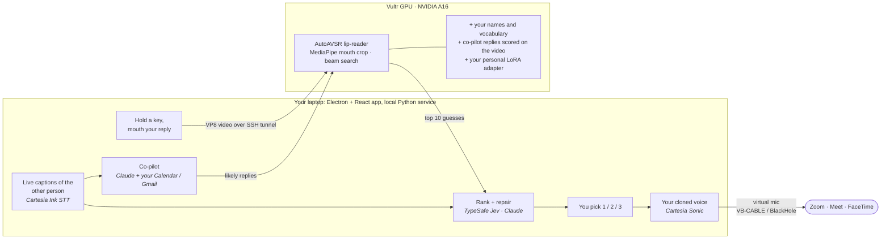

<div align="center">


# Silent Calls

### Take a call without making a sound.

Mouth your reply at your webcam. Silent Calls reads your lips, works out what you meant from the conversation,
and says it into Zoom, Meet or FaceTime **in your own cloned voice**.


[](requirements.txt)
[](server/requirements-gpu.txt)
[](client/package.json)
[](silentcalls/copilot.py)
[](silentcalls/voice.py)
[](server/setup_gpu.sh)

[How it works](#how-it-works) · [Results](#results) · [Built with](#built-with) · [Run it](#run-it) · [Privacy](#privacy-and-safety) · [Full results log](docs/RESULTS.md)

</div>

---

<table>
<tr>
<td align="center" width="25%"><h2>77%</h2>right sentence on top when the co-pilot anticipated the reply<br/><sub>up from 36% lip-reading alone</sub></td>
<td align="center" width="25%"><h2>0.92 s</h2>key release → candidates on the GPU<br/><sub>1.3 s over venue Wi-Fi</sub></td>
<td align="center" width="25%"><h2>~90 ms</h2>pick → first audio in your cloned voice<br/><sub>Cartesia Sonic</sub></td>
<td align="center" width="25%"><h2>35 s</h2>to train your personal lip-reading adapter<br/><sub>WER 37% → 31% on unseen sentences</sub></td>
</tr>
</table>

## Why

Some people can move their lips but can't speak aloud: after a laryngectomy or vocal-cord surgery, with
voice loss from ALS or Parkinson's, on doctor-ordered voice rest. Everyone else sometimes needs to answer a call
where they can't talk: a library, a hospital ward, next to a sleeping baby.

Today the options are typing into a chat box (if the call has one) or not taking the call. **Silent Calls keeps
them in the conversation, in their own voice**, on the call apps they already use, with no extra hardware beyond
a webcam.

## How it works



1. **The other person talks.** Their audio is captioned live with Cartesia speech-to-text, recorded from your
   speakers (no second cable on Windows).
2. **The co-pilot prepares your likely replies.** Claude reads the conversation and, with read-only access to your
   calendar and email, drafts what you'll probably say. Asked *"are you free Tuesday?"*, it already has *"I'm free
   after 3 on Tuesday"* ready, citing the calendar entry it used.
3. **You mouth your reply** while holding a key. The GPU lip-reader decodes the video and also scores the
   co-pilot's replies against the same video. Your lips pick the reply; the co-pilot supplies what lips can't carry
   (times, order numbers, names).
4. **Jev ranks the options with the conversation**, and Claude offers a repaired sentence if the lip-reader is off
   (lip-reading confuses p/b/m, f/v, and so on).
5. **You pick one** (keys 1–3) and it's spoken in your cloned voice. **Nothing is ever spoken without your pick.**

It gets better the more you use it: a 10-minute calibration (30–60 sentences, including ones with your own name and
vocabulary) trains a personal adapter in about 35 seconds, and after each call a **coach agent** proposes words and
practice sentences from the places lip-reading struggled.

## Results

Measured on **90 silently mouthed call sentences from 3 people**, recorded on ordinary laptop webcams, plus
spoken-aloud clips as a control. With no training on our data, the pretrained lip-reader puts the right sentence
first **36%** of the time and in its top 10 **56%** of the time; everything below builds on that. Each accuracy
number links back to a run folder in [`server/results/`](server/results/) with per-clip CSVs and every N-best list;
the full log with all sweeps and timings is [docs/RESULTS.md](docs/RESULTS.md).

> **Metrics.** *WER*: word error rate of the top guess. *exact@K*: the exact sentence is among the top K guesses.
> *within1@5*: some top-5 guess is at most one word off.

### Headline

| | Before | After |
|---|---|---|
| **Co-pilot anticipated the reply** (closed-set scoring, +60 ms) | top guess 36%, WER 37% | top guess **77%**, top 3 **84%**, WER **19%** |
| **Jev reranking with the call context** | top 1 31%, top 3 41% | top 1 **42%**, top 3 **56%** |
| **Personal LoRA adapter**, sentences it never saw | WER 37%, exact@5 49%, within1@5 64% | WER **31%**, exact@5 **56%**, within1@5 **73%** |
| Same adapter on *someone else's* lips (control) | WER 37% | WER 37%: **the gain is personal** |

### Latency, end to end

| Stage | Measured |
|---|---|
| Lip-read after key release (A16, face detection hidden during the hold) | **0.92 s** median |
| Key release → candidates on the laptop, over venue Wi-Fi | **1.3 s** median |
| Jev ranking (warm connection) | **80–250 ms** |
| Pick → first audio in your cloned voice | **87–95 ms** |
| Co-pilot replies ready after the other person's line | **2.3 s** (2.9 s with an email search) |
| Claude repair offered as an extra option | ~3 s |
| Personal adapter training (1.2M params, 0.5% of the model) | **~35 s** on one A16 |

<details>
<summary><b>Closed-set scoring: how the co-pilot's replies reach the lip-reader</b></summary>
<br/>

The lip-reader scores each prepared reply against the video with the same decoder + CTC + LM log-probability a
beam hypothesis would get, then ranks it alongside its own guesses. Among a short list, **the true sentence is the
best-scoring one 98–99% of the time**, but the beam's own best guess always wins on likelihood alone, so prepared
replies get a prior bonus *B*. Choosing *B* offline ([`given_scores`](server/results/given_scores/sweep.md), lists
of 5):

| B | truth among 4 others: top 1 | truth among 4 look-alikes: top 1 | only one-word-off replies: a wrong one wins |
|---|---|---|---|
| 0 | 32% | 32% | 0% |
| 4 | 59% | 59% | 0% |
| **8** | **77%** | **77%** | **1%** |
| 12 | 88% | 88% | 16% |
| 15 | 90% | 90% | 53% |

Through the real decoding path at B = 8 ([`given_d4_bonus8`](server/results/given_d4_bonus8/summary.md)):

| Co-pilot's list | WER | exact@1 | exact@3 | wrong reply on top |
|---|---|---|---|---|
| none (lip-reading alone) | 37% | 36% | 43% | – |
| contains what was said (+4 other sentences) | **19%** | **77%** | **84%** | 0% |
| contains what was said (+4 look-alikes) | **19%** | **77%** | **84%** | 0% |
| doesn't contain it | 37% | 36% | 43% | 0% |

When the co-pilot is right, the right sentence goes from top guess a third of the time to three times in four.
When it's wrong, **nothing gets worse**.

</details>

<details>
<summary><b>Personal adapters: cross-validated, with a control</b></summary>
<br/>

Rank-16 LoRA on the encoder's attention projections; frontend, decoder and LM frozen. 5-fold cross-validation by
sentence: every clip is scored by an adapter that never trained on it
([`lora_cv5_final_r16_s100_lm0.2`](server/results/lora_cv5_final_r16_s100_lm0.2/crossval.md)).

| | clips | WER | exact@1 | exact@5 | exact@10 | within1@5 |
|---|---|---|---|---|---|---|
| base model | 90 | 37% | 36% | 49% | 56% | 64% |
| **own adapter** (100 steps) | 90 | **31%** | **40%** | **56%** | **60%** | **73%** |
| other people's clips, someone else's adapter | 180 | 37% | 35% | 49% | 56% | 65% |

Per person, WER base → own adapter: Rahul 38% → **21%**, Sarvajith 15% → 13%, Nilesh 59% → 58% (his clips were
cut off and fast, which no adapter fixes).

**How much calibration is enough?** Same setup, training on only N sentences:

| training sentences | 0 | 6 | 12 | 18 | 24 |
|---|---|---|---|---|---|
| WER | 37% | 38% | 34% | **28%** | 31% |
| exact@10 | 56% | 52% | 56% | **64%** | 60% |

Six sentences hurt (the adapter memorizes them); the full gain is there by 18. The app requires 30 clips (24 to
train, 6 for its before/after report) and asks for 60.

</details>

<details>
<summary><b>Bandwidth: making it work on venue Wi-Fi</b></summary>
<br/>

The venue uplink measured ~0.5 MB/s, too slow for JPEG frames. We switched the client to a VP8 stream from
`MediaRecorder` and decode on the server.

| Client sends | Upload | WER | exact@10 | Key release → candidates over venue Wi-Fi |
|---|---|---|---|---|
| JPEG 480p q80 | 1.1 MB/s | 37% | 56% | **10.7 s** median (1.8–23 s) |
| VP8 480p, 1 Mbps | 125 KB/s | 38% | 49% | **1.29 s** median (0.93–2.1 s) |
| VP8 480p, 2 Mbps (app default) | 250 KB/s | 37% | 53% | |

Also tested: 360p–720p frames, face crops from 96 to 320 px, JPEG quality 30–80, VP8 at 250 kbps–2 Mbps. Full
tables in [docs/RESULTS.md §2–3](docs/RESULTS.md#2-live-path-frames-streamed-as-jpegs-as-the-desktop-app-sends-them).

</details>

<details>
<summary><b>Names: vocabulary biasing without false positives</b></summary>
<br/>

Names are where lip-reading fails hardest, so names from your profile, saved vocabulary and the call captions bias
the beam search. On 102 clips with 8 names passed as vocabulary and **no names spoken**, a bias of 2.0 put **no
false name in any top 10**, for +75 ms ([`names_vocab_biasonly`](server/results/names_vocab_biasonly/summary.md)).
Lip-shape name swaps were noisy (*"like a"* looks like *"anika"*, *"pray"* like *"priya"*), so they're off by default.

Live, *"hi my name is Rahul"* came out as *"hi my name is **wrong**"*; Claude's repair, knowing "Rahul" is a likely
name, returned **"Hi, my name is Rahul."** as an option. That's why repair is part of the loop.

</details>

<details>
<summary><b>Decoder tuning, decision weights and the call loop</b></summary>
<br/>

- **Decoder sweep** ([`sweep.md`](server/results/sweep.md)): LM weight 0.0–0.5 × CTC weight 0.1/0.3, beam 20/40.
  Chose LM 0.2, CTC 0.1, beam 40 (best exact@1 and exact@10, and a lighter LM leaves room for conversation context).
- **Decision weights** (`silentcalls/fit_weights.py`): w_lip 0.5, w_jev 1.2. At combined score ≥ 0.97, 14 of 90
  clips were all correct. Auto-speak is still **off**: the user always picks.
- **Jev in practice:** with *"hi server jet yes i can"*, *"hi so very yes i can"*, *"hi sarvajith yes i can"* and
  Sarvajith as a likely name, Jev ranked the lip-reader's **third** guess first at 87%.
- **Keeping Jev warm** cut its latency from ~1 s (over the 0.5 s budget) to 98–245 ms.

</details>

<details>
<summary><b>Choosing the Claude model for the co-pilot</b></summary>
<br/>

[`tools/copilot_bench.py`](tools/copilot_bench.py): 12 scripted calls against a fake calendar and inbox (order
numbers, confirmation codes, calendar conflicts, an honest "let me check" when the fact doesn't exist), 3 runs per
model ([`results/copilot_models/`](results/copilot_models/)).

| Model | Right reply in list | Right reply first | Invented facts | Median latency (no search / search) | Cost per line |
|---|---|---|---|---|---|
| **Opus 5.5, fast mode** (shipped) | 100% | 97% | 0 | **1.4 s / 2.2 s** | $0.032 |
| Opus 5.5 | 100% | 100% | 0 | 3.3 s / 4.9 s | $0.016 |
| Sonnet 5.5 | 100% | 100% | 0 | 2.3 s / 3.9 s | $0.008 |
| Haiku 5.5 | 97% | 81% | 0 | 2.9 s / 3.8 s | $0.0005 |

Fast mode is the only setting with replies ready in about 2 s, before the user has finished mouthing. Sonnet 5.5 is
the fallback.

</details>

<details>
<summary><b>Post-call coach agent</b></summary>
<br/>

After a call, Claude Opus 5.5 reviews every line you spoke (what was shown vs. what was finally said) and calls
proposal tools; you approve each one in the widget. On a scripted call where *"Priya"* came out as *"pray"* and
*"Devansh"* as *"the bunch"*, it proposed **Priya, Devansh, Figma** and two practice sentences, each with quoted
evidence, in 15.9 s, and left the correctly read line alone. Approved words feed the decoder bias; approved
sentences become calibration prompts.

</details>

**Test data:** 3 people × 30 silently mouthed call sentences ([`server/eval_data/`](server/eval_data/)), plus
spoken-aloud clips. **Model:** AutoAVSR visual-only, LRS3 (`LRS3_V_WER19.1`, ~250M params) with its subword LM.
**Hardware:** Vultr, 2 × NVIDIA A16 (16 GB each). With 30 sentences per person, one clip is ~1.1 points overall,
so small differences are noise; we say so in the log wherever it matters.

## Built with

| | What it does in Silent Calls |
|---|---|
| **[Cartesia](https://cartesia.ai)** | The user's voice, end to end. **Voice cloning** from a short guided recording in onboarding ([`silentcalls/voice.py`](silentcalls/voice.py)); **Sonic TTS** speaks every picked reply in that voice, streamed as PCM into the virtual mic (~90 ms to first audio); **Ink STT** (streaming WebSocket) captions the other person word by word, feeding the co-pilot, Jev and Claude. |
| **[Claude](https://www.anthropic.com/api)** | Three agents, none of which ever speaks on its own. **Co-pilot** ([`silentcalls/copilot.py`](silentcalls/copilot.py)): Opus 5.5 (fast mode, low effort) reads the conversation and calendar, decides whether to search Gmail (a tool it calls with Gmail search syntax), and returns up to 4 replies with the facts and sources it used. **Repair** ([`silentcalls/decision.py`](silentcalls/decision.py)): proposes the sentence you most likely meant from the top 10, accounting for lip-reading confusions. **Coach** ([`silentcalls/coach.py`](silentcalls/coach.py)): reviews the call and proposes fixes. Structured outputs throughout; server-side refusal fallbacks enabled. |
| **[Vultr Cloud GPU](https://www.vultr.com/products/cloud-gpu/)** | An NVIDIA A16 (2 × 16 GB) runs the lip-reader as a `systemd` service ([`server/lipread.service`](server/lipread.service)). GPU 0 serves calls; GPU 1 trains personal adapters so training never slows a call. Every evaluation in this README ran there. |
| **TypeSafe Jev** | Decision layer ([`silentcalls/decision.py`](silentcalls/decision.py)): one choice question over the top 10 with the live conversation as state; its probabilities are fused with lip scores (weights fitted on our clips). |
| **Google Calendar + Gmail APIs** | Read-only, your own account ([`silentcalls/google_data.py`](silentcalls/google_data.py)): the next 7 days of events go into the co-pilot's context; Gmail search is a tool it calls when the conversation needs a fact. Snippets only, never stored or logged. |
| **AutoAVSR + ESPnet (PyTorch)** | The visual speech recognition model and beam search, which we extended with vocabulary bias, closed-set scoring of given sentences, and per-user LoRA adapters ([`server/lipread/`](server/lipread/), [`server/lora/`](server/lora/)). |
| **MediaPipe** | Face landmarks for the mouth crop on the GPU, and a local mouth-movement meter in the app. |
| **Electron + React** | The desktop app: onboarding, voice cloning, calibration, an always-on-top meeting widget, a global hold-to-talk key, and the SSH tunnel to the GPU (opened automatically). |
| **VB-CABLE / BlackHole, WASAPI loopback** | The virtual microphone your cloned voice plays into, and call-audio capture for captions. |

## Run it

**Prerequisites:** Python 3.11, Node 22.12+, a webcam, API keys for Cartesia, Anthropic and TypeSafe, and a GPU
host for the lip-reader.

**1. Local service**

```sh
python -m venv .venv
.venv/Scripts/pip install -r requirements.txt      # macOS/Linux: .venv/bin/pip
cp .env.example .env                               # add CARTESIA_API_KEY, ANTHROPIC_API_KEY, TYPESAFE_API_KEY
```

In `.env`, set `VIRTUAL_MIC_DEVICE=CABLE Input` (Windows) or `BlackHole 2ch` (macOS).

**2. Virtual microphone.** Install [VB-CABLE](https://vb-audio.com/Cable/) (Windows) or
[BlackHole 2ch](https://existential.audio/blackhole/) (macOS). In Zoom/Meet, set the **microphone** to CABLE Output
/ BlackHole 2ch and keep the **speaker** on your real speakers.

**3. GPU server.** Run [`server/setup_gpu.sh`](server/setup_gpu.sh) on a Vultr GPU instance, then
`systemctl start lipread`. The app reaches it through an SSH tunnel it opens itself (`~/.ssh/vultr_lipread`;
override with `SILENT_SSH_KEY`, `SILENT_SSH_HOST`).

**4. Optional:** Google sign-in for the co-pilot's calendar and email, read-only: [docs/COPILOT.md](docs/COPILOT.md).

**5. Launch**

```sh
cd client
npm ci
npm run dev
```

The app walks you through onboarding (camera, voice clone, meeting audio, calibration) and starts the local
service itself. To check every piece at once:

```sh
python tools/check_setup.py          # local checks + GPU reachability, no paid API calls
python tools/check_setup.py --live   # also one tiny request each to Jev, Claude and Cartesia
```

## Privacy and safety

- **Nothing is spoken without your pick.** Jev and Claude only rank and suggest; auto-speak is off.
- **Video stays in memory.** Webcam frames are processed and dropped. Only calibration clips are kept, and only as
  96×96 mouth crops with their sentence, per user.
- **Your adapter and vocabulary are yours**, loaded only for your profile.
- **Google access is read-only**, snippets only, nothing logged. The co-pilot shows where every fact came from and
  can be switched off in the widget.
- **No keys in the repo.** Secrets live in `.env` and `~/.silentcalls/`.

## Known limits

- **Lip-reading is hard.** Alone, the right sentence is the top guess about a third of the time. The product is
  designed around that: three options to pick from, Jev's ranking, Claude's repair, the co-pilot, a personal adapter.
- **Names and rare words** need to be in your vocabulary (or said in the call); even then a strong look-alike can
  win, and Claude's repair is the dependable fix.
- **Numbers barely show on lips**; the co-pilot supplies them from your calendar and email.
- **Small test set:** 3 people, 30 sentences each. Decision thresholds were fitted and scored on the same clips.
- **Single-user GPU server** reached over SSH; no multi-user authentication yet.

## Repository

```
client/            Electron + React app: widget, onboarding, calibration, SSH tunnel
silentcalls/       Local Python service: captions, co-pilot, coach, decision (Jev + Claude), Cartesia voice
server/lipread/    GPU lip-reading service: model, vocab bias, given-sentence scoring, HTTP + WebSocket
server/lora/       Personal adapters: enrollment data, trainer, cross-validation
server/eval*.py    The evaluations behind every number in docs/RESULTS.md
server/results/    Every run: summaries, per-clip CSVs, N-best lists
tools/             Setup checker, co-pilot benchmark, WebSocket replay, Jev smoke test
docs/              Architecture, protocol, results, setup guides
tests/             Python tests (app tests in client/tests/)
```

Deeper reading: [Architecture](docs/ARCHITECTURE.md) · [WebSocket protocol](docs/PROTOCOL.md) ·
[Results log](docs/RESULTS.md) · [Co-pilot setup](docs/COPILOT.md)

## Team

| | |
|---|---|
| **Sarvajith** | Desktop app: capture, global hold-to-talk, onboarding, calibration, meeting widget |
| **Rahul** | GPU lip-reading: model serving, vocabulary bias, closed-set scoring, LoRA adapters, evaluation |
| **Nilesh** | Voice and decisions: Cartesia cloning, TTS and captions, Jev + Claude decision layer |

## Acknowledgements

The lip-reader is **AutoAVSR** (Ma et al., *Auto-AVSR: Audio-Visual Speech Recognition with Automatic Labels*,
ICASSP 2023) via
[mpc001/Visual_Speech_Recognition_for_Multiple_Languages](https://github.com/mpc001/Visual_Speech_Recognition_for_Multiple_Languages).
Its weights are licensed for non-commercial research use.

<div align="center">
<sub>Built in 36 hours at Cal Hacks 13.0 by Rahul, Sarvajith and Nilesh.</sub>
</div>
